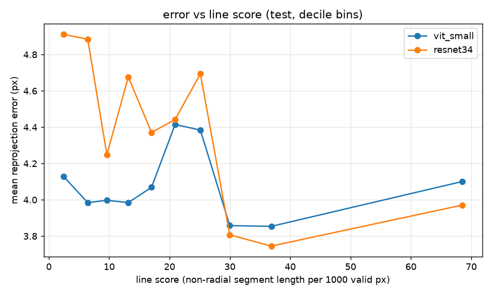
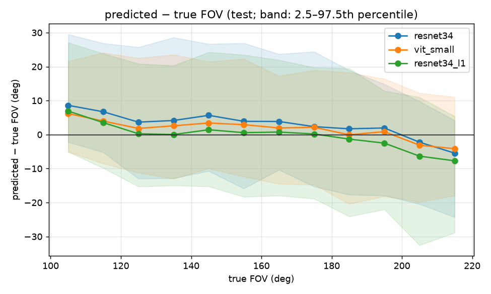
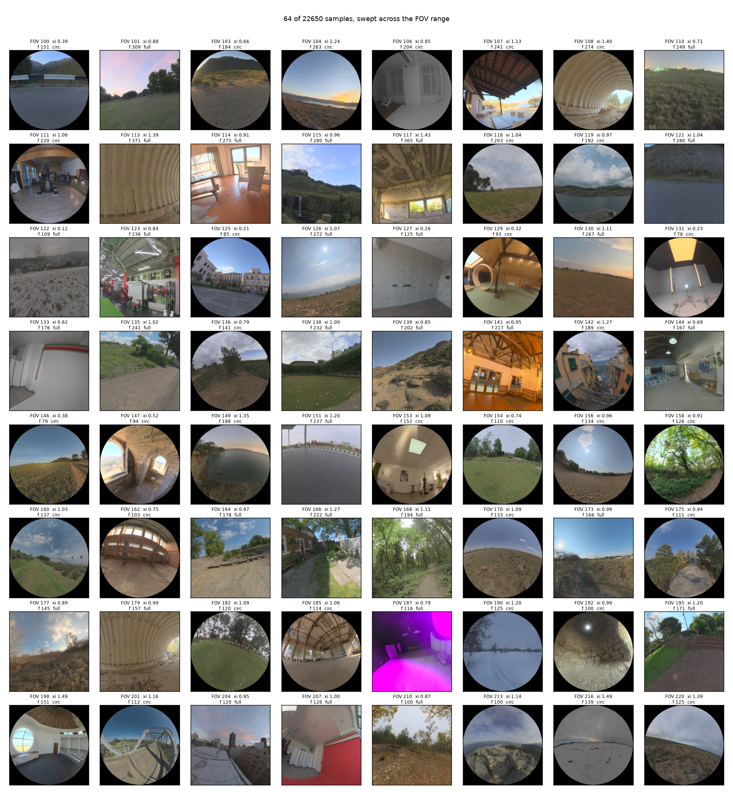
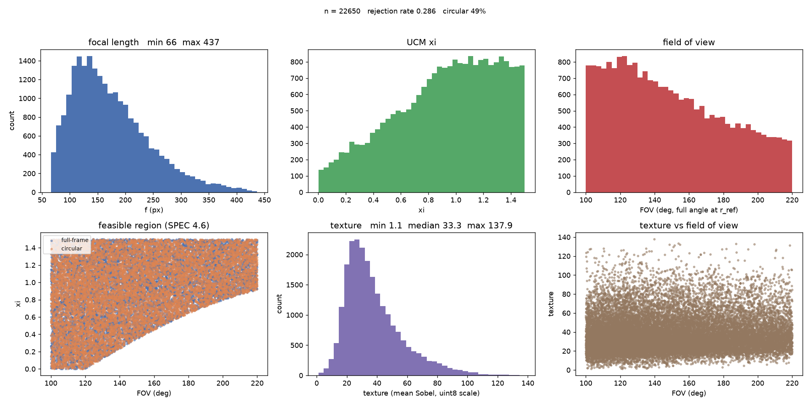

# Single-image fisheye calibration: ResNet-34 vs ViT-S/16

**TL;DR.** A network reads one 224×224 fisheye image and regresses the Unified Camera Model
intrinsics `(f, ξ)`. No calibration target is used. Training data is rendered from 997
[Poly Haven](https://polyhaven.com/) HDRI panoramas, and an ImageNet-pretrained ResNet-34 and
ViT-S/16 are compared under identical data, loss and schedule, each at its own tuned
learning rate, with 3 seeds each. On the held-out test set, which was evaluated once
against a pre-registered protocol, **ViT-S/16 has lower reprojection error than ResNet-34
in this setting**: the paired difference is **−0.298 px (95% CI [−0.454, −0.150])**, or
−0.20% of the reference radius (95% CI [−0.32%, −0.09%]).

---

## Headline results (test)

*The test split (1,780 images from 89 panoramas, none seen in training or model selection)
was evaluated once.*

| model | runs | reproj. error (px) | % of r_ref | f MAE (px) | ξ MAE |
|---|---:|---:|---:|---:|---:|
| best constant `(f, ξ)` (no image) | 1 | 14.656 | 10.94 | 205.77 | 2.040 |
| ResNet-34, geometric loss | 3 | 4.375 ± 0.042 | 3.24 ± 0.04 | 34.47 ± 0.74 | 0.255 ± 0.006 |
| **ViT-S/16, geometric loss** | 3 | **4.078 ± 0.032** | **3.05 ± 0.03** | 27.76 ± 0.37 | 0.198 ± 0.003 |
| ResNet-34, `param_l1` loss | 1 | 4.659 | 3.45 | 20.42 | 0.118 |

**Paired ViT − ResNet** (per-image error averaged over seeds, panorama bootstrap):
−0.298 px [−0.454, −0.150]; −0.20% [−0.32%, −0.09%] of `r_ref`.

- **Uncertainty:** `±` is the standard deviation across seeds.
- **What "% of r_ref" means:** the error divided by the image's reference radius. See
  [Problem setup](#problem-setup) for why that matters.
- **Provenance:** test was evaluated once (`evaluate.py --final`). The results were committed
  in `0de99c3`, generated from code at `73b7939`.
- **Full output:** [`results/summary.md`](results/summary.md) holds every table.

---

## Key findings

*Five things the test evaluation shows. Each holds in this setting and on this synthetic
dataset only.*

**a. ViT beats ResNet, but val made the gap look larger than it is.**
- The val preview gave −0.380 px; test gives −0.298 px, about 20% smaller.
- The seed spread was also compressed on val:
  - ViT: ±0.002 px on val, ±0.032 px on test.
  - ResNet: ±0.028 px on val, ±0.042 px on test.
- Val chose the learning rates and checkpoints, which is why only test is reported as the
  result.

**b. ViT's advantage comes from images with few straight lines, full-frame images and narrow
views.** On images with many straight lines, ResNet is no worse. These are per-stratum means,
in % of `r_ref`, with no CI per stratum:

| stratum (test) | ResNet-34 | ViT-S/16 |
|---|---:|---:|
| line score Q1 (fewest lines) | 3.65% | 3.05% |
| line score Q5 (most lines) | 2.83% | 2.98% |
| full-frame | 3.22% | 2.89% |
| circular | 3.26% | 3.19% |
| FOV 100–130° | 3.53% | 3.23% |
| FOV 190–220° | 2.60% | 2.54% |



The line score is the length of straight, non-radial segments per 1000 valid pixels; see
[Evaluation protocol](#evaluation-protocol). The figure is in px, which mixes the two image
shapes, so read the table for the comparison.

**c. A parameter loss gives more accurate parameters and a worse projection, and the
geometric loss systematically overestimates FOV.**

Same architecture (ResNet-34) and the same learning rate; only the loss differs:

| | `param_l1` | geometric |
|---|---:|---:|
| f MAE (px) | 20.42 | 34.47 |
| ξ MAE | 0.118 | 0.255 |
| reprojection error (px) | 4.659 | 4.375 |
| mean FOV bias | +0.58° | +3.78° |

- **Reprojection cost shrinks on test:** `param_l1` costs 15% more reprojection error on val
  (4.868 vs 4.232 px) and 6.5% more on test.
- **Geometric loss overestimates FOV:** ViT, also trained with the geometric loss, has +2.21°
  mean FOV bias.
- **Caveat:** the `param_l1` arm is a **single seed with no CI**, so treat the size of the
  effect with caution.



**d. Both models have a generalisation gap of roughly 1.5 px.** Error rises from
`train_clean` (2,000 un-augmented train images) to test:
- ResNet-34: 2.888 → 4.375 px (+1.487).
- ViT-S/16: 2.368 → 4.078 px (+1.710).

**e. Out of distribution (Pure Skies panoramas), ViT has no advantage.**
- ResNet-34 scores 7.168 ± 0.091 px and ViT-S/16 scores 7.479 ± 0.708 px.
- ViT's seed spread is several times larger than ResNet's.

---

## Problem setup

*The model has two unknowns. They are partly degenerate, so the project scores the
projection rather than the parameters.*

The Unified Camera Model maps a ray at angle `θ` from the optical axis to image radius

```
r(θ) = f · sin θ / (ξ + cos θ)
```

- **References:** C. Geyer and K. Daniilidis, "A Unifying Theory for Central Panoramic
  Systems", ECCV 2000; C. Mei and P. Rives, "Single View Point Omnidirectional Camera
  Calibration from Planar Grids", ICRA 2007.
- **Special cases:** `ξ = 0` is a pinhole (`r = f·tan θ`); `ξ = 1` is stereographic.
- **Principal point:** fixed at the image centre, which is a deliberate simplification.
- **Validity boundary:** beyond `θ_max(ξ) = arccos(−min(ξ, 1/ξ))` the radius stops increasing
  and two directions map to one pixel. A training loss has to handle predictions that cross
  this boundary.

**Why reprojection error and not parameter error.**
- **The parameters are partly degenerate:** a larger `ξ` paired with a larger `f` produces
  nearly the same radial profile, so `(f, ξ)` can be far off while the image geometry is
  nearly right.
- **The constant baselines show this** (test):

  | constant predictor | reproj. error | f MAE | ξ MAE |
  |---|---:|---:|---:|
  | train mean (`f` = 161.2, `ξ` = 0.920) | 17.341 px | 53.33 px | 0.319 |
  | best single `(f, ξ)` (`f` = 375.1, `ξ` = 2.939) | 14.656 px | 205.77 px | 2.040 |

  The best constant drifts to `ξ` = 2.939, far outside the sampled range of 0–1.5. Its
  parameter errors are far worse than the mean's, yet its projection is better.
- **The metric:** compare `r_pred(θ)` with `r_true(θ)` on 64 angles from the centre to the
  edge of the true field of view, and average the absolute difference in pixels.

**Why normalise by `r_ref`.** The FOV is defined at a reference radius:
- `r_ref` = 112 px for a circular fisheye and 158 px for full-frame (the half-diagonal).
- The same angular mistake therefore costs about 41% more pixels on a full-frame image.
- On test, ResNet's full-frame error is 5.105 px vs 3.655 px circular. As a fraction of
  `r_ref` the two are 3.22% vs 3.26%.
- Pixel numbers are kept for continuity with the training logs, and every table also reports
  the percentage.

---

## Data

*The images are rendered from 360° panoramas so the labels are exact, the camera covers the
full 100–220° range, and scenes can be split without leakage.*

**Why panoramas rather than perspective photos.** An equirectangular panorama holds every
viewing direction, so any `(f, ξ)` and any orientation can be rendered with an exact label.
A perspective photo cannot be re-rendered beyond its own field of view, and fisheye lenses
reach 220°.

**Rendering.**
- **Source resolution:** panoramas are resized to 1024×512.
- **Supersampling:** each view is rendered at 4× resolution and reduced with `INTER_AREA`.
- **Why supersample:** without it, point sampling aliases, and the aliasing pattern depends on
  how the lens resamples the panorama, that is, on `(f, ξ)`. A network could learn to read the
  intrinsics from the artefacts, a cue no real lens produces.
- **Mask:** pixels outside the valid mask are 0.

**Camera sampling.**
- **Ranges:** `(FOV, ξ)` are drawn uniformly from 100–220° × 0–1.5, with 50% of views
  circular, yaw over the full circle, pitch ±30° and roll ±15°.
- **Rejection:** a draw is kept only if it meets all four feasibility conditions below; about
  0.29 of draws are rejected. With `θ = FOV/2`:

  1. `ξ + cos θ ≥ 0.05`, so `f` is positive and not near 0.
  2. If `ξ > 1`: `cos θ ≥ −1/ξ + 0.05`, so the whole view stays inside the one-to-one region.
  3. `f ≥ 30 px`.
  4. **Edge magnification `M = (1 + ξ)(1 + ξ cos θ) / (ξ + cos θ)² ≤ 4`.** `M` is the ratio of
     radial sampling density at the rim to that at the centre. A large `M` means the rim is
     smeared across many pixels that carry almost no information. `M = 4` is a 120°
     rectilinear lens, `M = 1` an equidistant lens, and a 220° stereographic lens has
     `M = 3.04`. The cap mostly removes low-`ξ`, wide-FOV cameras.




**Splitting by group.** Poly Haven ships many variants of one capture: different times of
day, `_puresky` versions and numbered series. Splitting per asset would put the same scene
in train and test, so assets are grouped first:
- **Two relations:** assets are related by a shared `collection:` tag or by the same filename
  stem (after stripping suffixes such as `_2k`, `_dawn`, `_puresky`).
- **Groups:** a group is a connected component of the two relations (union-find). Either
  relation alone splits some captures across splits.
- **Assignment:** whole groups go to train/val/test at 80/10/10, stratified by primary
  category.

| split | panoramas | views per panorama | images |
|---|---:|---:|---:|
| train | 755 | 30 | 22,650 |
| val | 94 | 20 | 1,880 |
| test | 89 | 20 | 1,780 |
| stress | 59 | 20 | 1,180 |

**Stress set.** Assets whose primary category is *Pure Skies* are removed from
train/val/test and kept as an out-of-distribution set: mostly sky with little structure.
- **Removed per asset:** the rest of each group stays in the core splits.
- **Accepted overlap:** most stress panoramas share a capture with a training panorama. This
  is accepted because the label (the camera) is sampled independently of the scene.
- **Measuring the overlap:** of the 59 stress panoramas, 49 have their sibling in train and
  10 in val/test. `results/summary.md` reports the two groups separately.

---

## Training

*Each architecture gets its own learning rate. Everything else is held fixed so that the
difference can be attributed to the architecture.*

| | ResNet-34 | ViT-S/16 |
|---|---|---|
| model | `timm` `resnet34`, ImageNet-pretrained | `timm` `vit_small_patch16_224`, ImageNet-pretrained |
| learning rate | 3.0e-3 (swept) | 5.0e-5 (swept) |
| weight decay | 1.0e-4 | 0.05 |
| shared | AdamW, 500 warm-up steps, cosine to 0, 6,000 steps, batch 128, bf16, grad-clip 1.0 | same |

**Targets and loss.**
- **Targets:** the network outputs standardised `[log f, ξ]`, with statistics from train only.
- **Loss terms:** a smooth-L1 between predicted and true radial profiles over the valid angles,
  plus a hinge barrier on `ξ + cos θ` and `1 + ξ cos θ`.
- **Why the barrier:** masking invalid angles removes their gradient, and clamping the
  denominator is no better because a clamp is flat. The barrier is the term that pushes a
  prediction back into the valid region.
- **Augmentation:** photometric augmentation plus flips and 90° rotations, which leave the
  intrinsics unchanged. Crops, scaling and arbitrary rotations would change the label and are
  not used.
- **Checkpoint:** the best checkpoint is chosen by val reprojection error, evaluated every
  500 steps.

**Learning-rate sweeps** (seed 0, best val reprojection error, px):

| ResNet-34 lr | val | | ViT-S/16 lr | val |
|---|---:|---|---|---:|
| 1.0e-4 | 5.56 | | 2.0e-5 | 4.09 |
| 3.0e-4 | 4.98 | | **5.0e-5** | **3.86** |
| 1.0e-3 | 4.32 | | 1.0e-4 | 3.92 |
| **3.0e-3** | **4.22** | | 2.0e-4 | 4.18 |
| 1.0e-2 | 4.75 | | | |

- **U-shaped curves:** both curves rise on both sides of the selected value, so neither
  optimum sits at the edge of its range. Both sweeps were extended until this was true.
- **Very different optima:** the two optima are about 60× apart. A shared learning rate would
  have compared a tuned model with an untuned one.

**Seeds.** The selected settings were run with 3 seeds (best val reprojection error, px):

| seed | ResNet-34 (3.0e-3) | ViT-S/16 (5.0e-5) |
|---|---:|---:|
| 0 | 4.2156 | 3.8552 |
| 1 | 4.2646 | 3.8505 |
| 2 | 4.2155 | 3.8515 |

**Overfit check.** Before long runs, `train.py --overfit-batch 300` checks that each model can
fit a single batch.
- **ResNet:** at 3e-4 it converges cleanly.
- **ViT-S/16:** at the same rate its loss swung between 0.006 and 0.056 and ended 54× short of
  the ResNet. That is why ViT got its own sweep.
- **Limit of the check:** the sweep later showed the short diagnostic pointed in the right
  direction but did not pick the best value (1e-4 vs 5e-5).

---

## Evaluation protocol

*The test analysis was written down before test was read. The main comparison has a fixed
decision rule and a CI that respects how the data is correlated.*

**Pre-registration.** [SPEC.md §3.14](SPEC.md#314-最終評估的預先登記) fixes four things
before evaluation:
- the primary metric: test mean reprojection error, in px and % of `r_ref`;
- the primary comparison and its decision rule;
- the secondary analyses and three directional predictions;
- the known limitations.

It was committed in `73b7939`; the single `--final` run is committed in `0de99c3`. The
analysis code had already run end to end on val (labelled *preview*), so test was spent only
once.

**The primary comparison was not blind.** Before the protocol was registered, the full
analysis had already been run on val, where ViT − ResNet was −0.380 px (95% CI [−0.545,
−0.222]). The direction was therefore known in advance. Test's role is to check whether that
direction and size hold on data that played no part in any choice (SPEC §3.14.4).

**Decision rule** (SPEC §3.14.2):
- **ViT better:** the px and % 95% CIs both lie below 0. This is what happened.
- **Indistinguishable:** either CI contains 0.
- **ResNet better:** both CIs lie above 0.

**Panorama bootstrap.**
- **Why not per image:** the 20 views of one panorama share scenery, so their errors are
  correlated. A bootstrap over images would treat 1,780 images as independent and give an
  interval that is too narrow.
- **Procedure:** each of 1,000 replicates (seed 0) resamples the 89 panoramas with
  replacement, and every view of a drawn panorama comes with it.
- **What the CI covers:** it covers panorama sampling, not training randomness. That is
  handled by averaging 3 seeds per image first.

**Sanity check.** Before reporting anything, `evaluate.py` recomputes each checkpoint's val
error and compares it with the value logged to MLflow during training. It aborts if they
differ by 0.01 px or more. All 7 runs agree to 0.00000 px.

**Line score.**
- **Detector:** OpenCV's LSD finds segments ≥ 8 px with the midpoint inside the (eroded)
  valid mask.
- **Non-radial:** the midpoint is at least 0.2·`r_ref` from the centre and the segment is at
  least 30° off the radial direction. These are the lines the distortion visibly bends.
- **Score:** their total length per 1000 valid pixels.
- **How it was chosen:** the parameters were fixed in advance and not tuned.

---

## Predictions vs outcomes

*Three directional predictions were registered after the val preview and before test (SPEC
§3.14.3, items 5–6). One holds, one holds for ResNet only, and one is not supported.*

| prediction | val (preview) | test | verdict |
|---|---|---|---|
| **(a)** error falls as line score rises | ResNet 3.44% (Q1) → 2.79% (Q5), monotone. ViT 2.86% → 2.62%, not monotone. | ResNet 3.65% → 2.83%, monotone. ViT 3.05% → 2.98%, flat. | ResNet: supported. ViT: not supported. |
| **(b)** the most textured quintile has the largest share of low-line images | 18% in the top texture quintile vs 78% in the bottom | 15% vs 92% | **Not supported on val or test.** The trend is reversed. |
| **(c)** predicted FOV too low at wide views, too high at narrow ones (negative slope) | slope ResNet −0.085 [−0.099, −0.073], ViT −0.060 [−0.072, −0.046] | slope ResNet −0.089 [−0.104, −0.076], ViT −0.067 [−0.082, −0.054] | Supported. The geometric-loss models also carry a positive overall offset (ResNet +3.78°, ViT +2.21° on test). |

---

## What I got wrong

*Three beliefs I held during the project that the data contradicted.*

- **"ResNet is underfitting."**
  - *Belief:* the final train and val losses were nearly equal (`resnet34_pre_p100_geo_s0`,
    lr 3e-4: train loss 0.0194, val geometric loss 0.0203), so I concluded the model had high
    bias and no generalisation gap.
  - *What was wrong:* the train loss is computed on augmented images.
  - *Evidence:* `train_clean` measures fit on clean train images, and on it both models show a
    gap of about 1.5 px or more to test (finding d).
- **"Low texture is the main source of error."**
  - *Evidence against:* excluding frames with texture < 5 leaves ResNet's test error unchanged
    (4.375 → 4.375 px), and the most textured quintile is not the easiest.
  - *Why the guess was wrong:* the texture score measures edge density (mean Sobel magnitude),
    not straight lines. Foliage scores high and gives the model little geometric cue.
- **"(f, ξ) cannot be identified from the image."**
  - *Belief:* because a larger `ξ` with a larger `f` gives a similar profile, I claimed at one
    point that the parameters were not identifiable at all.
  - *Evidence against:* `param_l1` brings ξ MAE down to 0.118, and the fully trained
    geometric models also have lower parameter errors than the constant baselines (test f MAE
    34.47 / 27.76 px vs 53.33 px for the train mean).
  - *Correct statement:* there is an approximately degenerate direction along which the
    parameters change while the projection barely does.
- **Prediction (b).**
  - *How it was formed:* by generalising from the 8 worst val images, several of which were
    foliage.
  - *What was wrong:* that over-estimated how common foliage-like frames are among highly
    textured images.
  - *What I should have done:* checked the cross-tab on all of val before registering it. The
    cross-tab shows the opposite: highly textured frames usually have many straight lines.

---

## Limitations

- **Synthetic only.** All images are rendered from panoramas; nothing has been validated on
  real fisheye photographs, which have lens vignetting, chromatic aberration and an
  off-centre principal point.
- **Fixed principal point.** It sits at the image centre by construction, and the model does
  not estimate it.
- **One data source.** All scenes come from Poly Haven HDRIs and share its capture styles.
- **`param_l1` arm.** A single seed, run at the geometric loss's learning rate. It may not be
  at its own optimum, and it has no CI.
- **Small strata.** Test has 89 panoramas across 11 categories, and two categories have one
  panorama each. Read the `panoramas` column, not `n`.
- **Stress siblings.** Only 10 stress panoramas have no sibling in train, too few for a
  conclusion.
- **Best-constant baseline.** The grid search caps `ξ` at 3.0 and the optimum landed at 2.939,
  near that cap. A wider search (`--xi-max 6`) has not been run, so the baseline might be
  slightly stronger.

---

## Reproduce

*From an empty checkout to `results/summary.md`. The times below were measured on one RTX
4070 (12 GB).*

Requires Python ≥ 3.11 and [uv](https://docs.astral.sh/uv/). The CUDA torch wheel index is
pinned in `pyproject.toml`; pick the index that matches your driver.

```bash
uv sync

# 1. Download the panoramas (about 6.5 GB on disk at 2k)
uv run python -m data.download_polyhaven --out data_root/raw/polyhaven --res 2k

# 2. Group-aware stratified split
uv run python -m data.split --manifest data_root/manifest.json --out data_root/splits.json --seed 0

# 3. Render (train is about 3.2 GB; val, test and stress are under 300 MB each)
for s in train val test stress; do
  uv run python -m data.render_dataset --config configs/data.yaml --split $s --workers 8
done
uv run python -m tools.visualize_samples --root data_root --split train   # eyeball the data

# 4. Constant baselines
uv run python -m tools.baseline --root data_root

# 5. Training: 14 runs, typically about 17 min each (11.7–22.3 min in MLflow)
uv run python sweep.py configs/sweeps/resnet34_lr.txt
uv run python sweep.py configs/sweeps/vit_small_lr.txt
uv run python sweep.py configs/sweeps/resnet34_final.txt     # seeds 1–2 + param_l1
uv run python sweep.py configs/sweeps/vit_small_final.txt    # seeds 1–2

# 6. Evaluation: val/train_clean preview; add --final once for test and stress
uv run python evaluate.py --config configs/eval/final.yaml
```

- **Render times:** train took 1,045 s and val 167 s (from each split's `meta.json`).
- **`sweep.py`:** skips any run already FINISHED in MLflow, so an interrupted sweep resumes
  where it stopped.
- **Checkpoints:** about 1.2 GB for all runs.
- **Metrics:** stored in a local MLflow SQLite store, viewable with
  `uv run mlflow ui --backend-store-uri sqlite:///mlflow.db`.
- **Tests:** `uv run python -m pytest` runs the suite. It covers projection round-trips, the
  validity boundary, sub-pixel supersampling alignment, bit-identical rendering across worker
  counts, no group spanning two splits, and the evaluation guard that keeps test unread
  without `--final`.

---

## Repository layout

```
geometry/       UCM projection, rotations, equirectangular sampling, rendering (numpy)
data/           Poly Haven download, group-aware split, camera sampling, offline rendering
datasets/       torch Datasets, label-preserving augmentation, epoch-carrying sampler
metrics/        differentiable reprojection error, geometric and param_l1 losses (torch)
tools/          constant baselines, sample visualisation, category report
train.py        training loop shared by both architectures (MLflow logging, best checkpoint)
sweep.py        resumable sequential runner for a list of configs
evaluate.py     the only program that reads test/stress, and only with --final
configs/        data generation, per-run training configs, sweep lists, evaluation config
results/        summary.md / summary.json and figures from the final evaluation
docs/figures/   dataset figures used in this README
tests/          pytest suite
SPEC.md         design spec, decisions, sweep results and the pre-registration (in Chinese)
```

---

## Credits & license

- **Panoramas:** HDRIs from **[Poly Haven](https://polyhaven.com/)**, released under
  **[CC0](https://creativecommons.org/publicdomain/zero/1.0/)** and fetched through the
  [Poly Haven API](https://polyhaven.com/our-api). All scene content in this project, including
  the rendered example images in `docs/figures/` and `results/figures/`, comes from Poly
  Haven. Thanks to Poly Haven and its contributing artists.
- **Code:** MIT.
- **Tooling:** this project used Claude Code as a coding collaborator. Design decisions,
  reviews and corrections are recorded in [SPEC.md](SPEC.md).
